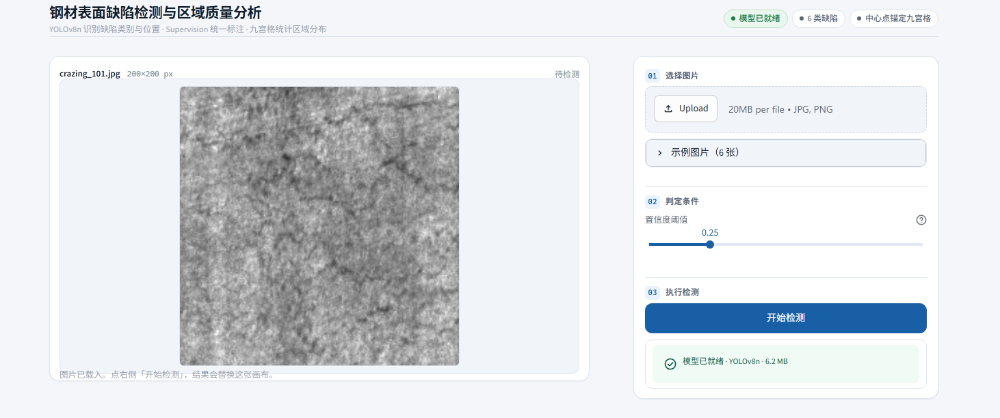
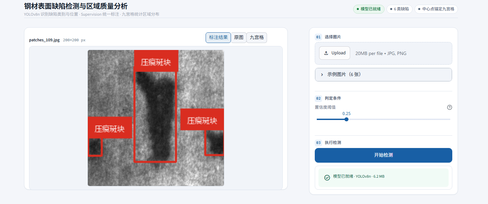

# 基于 Supervision 的钢材表面缺陷智能检测与区域质量分析系统

> 工业表面缺陷检测 · 目标检测结果可视化 · 缺陷空间分布分析
> 项目方案书对应版本：V1.0（2026-11-23）

YOLO 负责识别缺陷类别、置信度和边界框；**Supervision** 负责把模型输出统一
为 `sv.Detections`，绘制缺陷框与标签，并通过 `PolygonZone` 把产品表面划分成
九宫格，统计缺陷在各区域的分布情况。

这是一个基于公开数据集的**验证原型**，用于辅助人工复检与工艺排查，
不作为实际产线的质量判定依据。

---

## 界面



选图、调阈值、一键检测；结果按「指标 → 区域 → 明细」三段展开：



---

## 快速开始

### 1. 环境准备

```bash
cd steel-defect-supervision-demo

python -m venv .venv
.venv\Scripts\activate          # Windows
# source .venv/bin/activate     # Linux / macOS

pip install -r requirements.txt
```

> 若 pip 下载缓慢，可换用镜像：
> `pip install -i https://mirrors.aliyun.com/pypi/simple/ -r requirements.txt`

### 2. 准备数据集

数据集不随仓库分发，需自行获取（详见 [`data/README.md`](data/README.md)）：

```bash
git lfs install
git clone https://huggingface.co/datasets/KeenForgeAI/NEU-DET-corrected data/neu-det

python prepare_dataset.py       # 生成 70/15/15 分层划分与 data.yaml
python prepare_samples.py       # 导出 6 张演示样例到 samples/
```

> `samples/` 下的 6 张图片取自 NEU-DET，仅用于演示界面与命令行示例，
> 版权归数据集原作者；若不需要，删除该目录即可，页面会自动回到空状态。

### 3. 训练模型

```bash
python train.py --model weights/yolov8n.pt --epochs 30 --imgsz 640 --batch 8 --device cpu
```

训练完成后 `best.pt` 会自动复制到 `weights/`。

> 仓库已内置 `weights/yolov8n.pt` 作为预训练起点。若该文件缺失，
> 可从 <https://github.com/ultralytics/assets/releases> 下载 `yolov8n.pt`
> 放入 `weights/` 目录。

### 4. 启动 Web 页面

启动前先做一次环境自检，确认依赖、数据集与权重都就位：

```bash
python check_environment.py
```

然后启动：

```bash
streamlit run app.py
```

浏览器会打开 <http://localhost:8501>。页面默认进入**单张检测**，
在控制轨顶部的「单张检测 / 批量检测」之间切换；批量模式可勾选
「用六类样例组成一批」免上传演示。两种模式的说明见 [`docs/batch_mode.md`](docs/batch_mode.md)。

### 5. 命令行检测（可选）

```bash
python predict.py --image samples/crazing_101.jpg --conf 0.25
```

生成"标注图 + 九宫格热力图"对比图：

```bash
python demo_zone_analysis.py --image samples/crazing_101.jpg
```

### 6. 测试与评估

```bash
python -m pytest                 # 88 个单元测试
python evaluate.py               # 测试集评估，产出 outputs/reports/evaluation_report.json
```

---

## 功能一览

| 功能 | 说明 | 状态 |
|---|---|---|
| 检测模式 | 单张检测 / 批量检测，控制轨顶部切换，阈值共用 | 已实现 |
| 图片上传 | JPG / JPEG / PNG，带格式与体积校验（单张 ≤ 20 MB） | 已实现 |
| 检测参数 | 置信度阈值滑块，0.05–0.95 | 已实现 |
| 缺陷检测 | YOLO 推理，CPU 可运行 | 已实现 |
| Supervision 标注 | `BoxAnnotator` 画框 + `LabelAnnotator` 标注类别与置信度 | 已实现 |
| 缺陷统计 | 指标条、九宫格分布、置信度分级、缺陷明细表 | 已实现 |
| **3×3 区域分析** | `PolygonZone` 九宫格统计 + 缺陷集中区域 + 类别构成 | 已实现 |
| 批量检测 | 一次最多 20 张、逐张推理、进度条、整批汇总与明细、CSV 导出 | 已实现 |
| 结果下载 | 单张：标注图 PNG + 明细 CSV；批量：批次 CSV | 已实现 |
| 异常提示 | 格式错误、模型缺失、推理失败均有明确提示，不崩溃 | 已实现 |
| 中文字体 | 缺陷类别名用 PIL TrueType 渲染，不显示为 "??" | 已实现 |

---

## 项目结构

```text
steel-defect-supervision-demo/
├── app.py                     # Streamlit Web 主页面
├── train.py                   # 模型训练脚本
├── predict.py                 # 单张图片命令行检测
├── evaluate.py                # 测试集评估与实验报告
├── demo_zone_analysis.py      # 九宫格区域分析演示（生成对比图）
├── check_environment.py       # 启动前环境自检
├── prepare_dataset.py         # NEU-DET 分层划分
├── prepare_samples.py         # 导出演示样例图片
├── requirements.txt
├── README.md
├── data/
│   ├── README.md              # 数据来源、许可、划分说明
│   ├── dataset/data.yaml      # 划分后数据集配置
│   └── neu-det/               # 原始数据（不入库）
├── weights/
│   ├── best.pt                # 训练产出的权重（不入库）
│   └── yolov8n.pt             # 预训练起点
├── src/
│   ├── detection.py           # YOLO 推理封装
│   ├── annotation.py          # Supervision 标注逻辑
│   ├── chinese_label.py       # 中文字体标签渲染（兼容 cv2.putText 不支持中文）
│   ├── ui_theme.py            # 设计系统：token、全局样式、可复用组件
│   ├── ui_charts.py           # Plotly 图表统一样式
│   ├── batch.py               # 批量检测：逐张推理、失败隔离、汇总与 CSV
│   ├── zone_analysis.py       # 九宫格区域分析（核心创新点）
│   └── utils.py               # 图片与统计工具
├── samples/                   # 6 张演示样例图片
├── outputs/
│   ├── images/                # 检测结果图片
│   └── reports/               # 实验统计结果
├── docs/
│   ├── system_flow.md         # 系统流程与模块职责
│   ├── experiment.md          # 实验记录与真实指标
│   ├── contribution.md        # 个人贡献说明
│   ├── defense_script.md      # 答辩七分钟陈述稿与问答准备
│   ├── ui_design_system.md    # UI 设计系统与改造范围说明
│   └── todo.md                # 待办清单与次日接续说明
└── tests/                     # 单元测试（88 个）
```

---

## 核心创新点：九宫格空间分布分析

普通目标检测结果只给出"缺陷类别 + 边界框"。本项目在检测结果之上增加
基于 Supervision `PolygonZone` 的空间分布分析：

1. 把 YOLO 输出转换为统一的 `sv.Detections`；
2. 在视觉结果上同时标注缺陷类别、位置和置信度；
3. 把产品图像划分为九个区域，统计各区域缺陷数量与类别构成；
4. 指出缺陷集中区域，辅助人工复检与工艺排查。

归属规则统一取**检测框中心点**，落在分割线上的目标按固定顺序唯一归属，
保证"九宫格计数之和 = 参与统计的检测目标数"。

这是应用层的检测结果分析与可视化，**不改变模型精度**，不应表述为提高了 mAP。

---

## 环境与依赖

| 组件 | 版本 |
|---|---|
| Python | 3.13.14 |
| PyTorch | 2.15.0 (CPU) |
| Ultralytics | 8.4.216 |
| Supervision | 0.32.0 |
| OpenCV | 5.1.0.95 |
| Streamlit | 1.67.0 |
| pandas / plotly | 3.1.1 / 7.1.0 |

---

## 参考资料

- Supervision GitHub：<https://github.com/roboflow/supervision>
- Supervision 官方文档：<https://supervision.roboflow.com/>
- Ultralytics 官方文档：<https://docs.ultralytics.com/>
- Streamlit 官方文档：<https://docs.streamlit.io/>
- 数据集：<https://huggingface.co/datasets/KeenForgeAI/NEU-DET-corrected>
