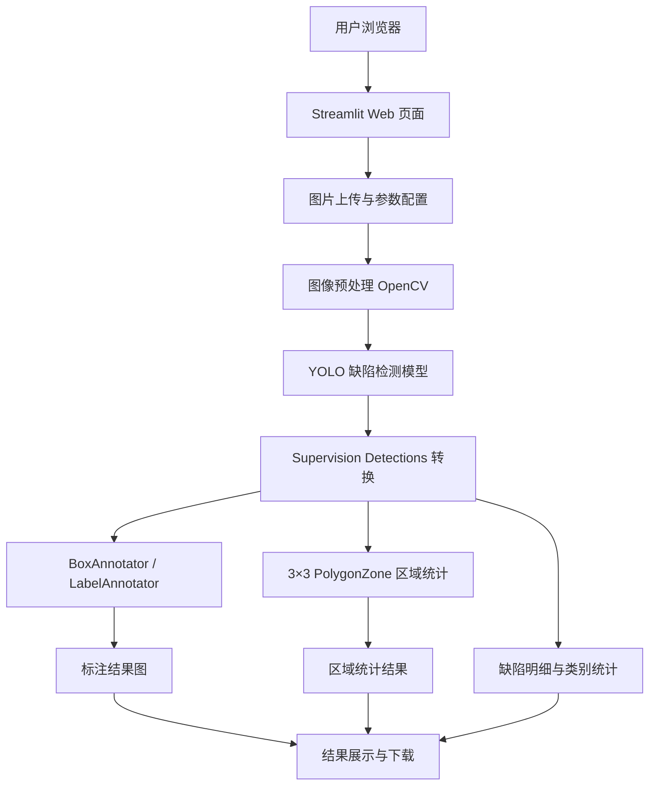
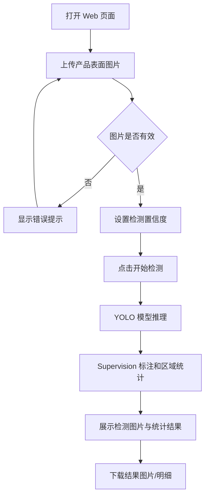

# 系统流程

## 1. 总体流程



## 2. 交互流程



## 3. 代码模块职责

| 模块 | 文件 | 职责 |
|---|---|---|
| 检测封装 | `src/detection.py` | 加载 YOLO 权重、执行推理、把 Ultralytics 结果转换为 `sv.Detections` |
| 标注 | `src/annotation.py` | 用 `BoxAnnotator` / `LabelAnnotator` 绘制缺陷框与类别标签 |
| 区域分析 | `src/zone_analysis.py` | 用 `sv.PolygonZone` 构建九宫格多边形，按中心点锚点统计各区域缺陷数 |
| 工具 | `src/utils.py` | 图片校验与编解码、缺陷汇总、明细转换 |
| Web 页面 | `app.py` | Streamlit 界面：上传、参数、展示、下载 |
| 命令行 | `predict.py` | 单张图片检测，输出标注图与区域统计 |
| 训练 | `train.py` | YOLO 训练脚本，产出 `weights/best.pt` |
| 评估 | `evaluate.py` | 在测试集上计算 Precision / Recall / mAP 与区域统计指标 |
| 数据整理 | `prepare_dataset.py` | NEU-DET 分层划分，生成 `data.yaml` |
| 测试 | `tests/` | 33 个单元测试，覆盖区域归属、标注、检测封装与工具函数 |

## 4. 关键处理顺序

单个检测流程的调用顺序：

```text
validate_upload(filename, size)      # 格式 / 大小校验
    ↓
decode_image_bytes(data)              # OpenCV 解码为 BGR 数组
    ↓
model = load_model("weights/best.pt") # Ultralytics 加载权重（Streamlit 中缓存）
    ↓
detect_image(model, image, conf)      # 推理 → sv.Detections.from_ultralytics()
    ↓
annotate_image(image, detections)     # BoxAnnotator + LabelAnnotator
    ↓
analyze_zones(detections, w, h)       # 9 个 sv.PolygonZone → 区域计数
    ↓
summarize_detections / detections_to_records  # 统计与明细
```

## 5. 九宫格归属规则

1. 图像按宽、高各三等分，形成九个矩形区域。
2. 每个区域构建为一个 `sv.PolygonZone`，锚点统一取检测框**中心点**
   （`sv.Position.CENTER`），要求锚点全部落在区域内。
3. 相邻区域共享分割线，中心点恰好落在分割线上时可能同时命中多个区域。
   实现上按**从上到下、从左到右**的固定顺序取第一个命中区域，
   保证每个检测目标只归属一个区域。
4. 中心点落在图像范围之外的检测目标记为"未归属"，不计入九宫格计数。

由此得到方案书 T08 的验收性质：**九个区域的计数之和等于参与区域统计的
检测目标数**（`assigned_count`），页面同时显示未归属数量以便核对。

## 6. 边界与限制

- Supervision 不负责训练，也不独立识别缺陷；缺陷识别由 YOLO 完成。
- 九宫格统计描述的是缺陷的空间分布，不代表缺陷严重程度或产品质量等级。
- "未检出缺陷"不等于"产品合格"，仅用缺陷样本训练不足以证明正常样本判定能力。
